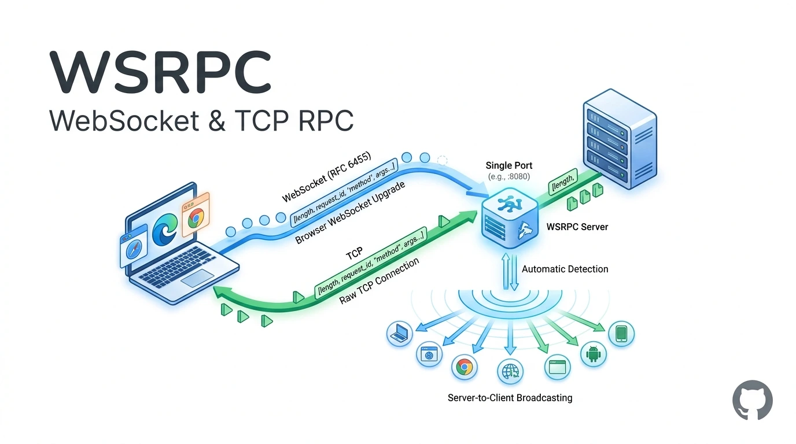

<div align='center'>



</div>

## What is WSRPC?

WSRPC is a dual-transport WebSocket (RFC 6455) and TCP procedure call library with server-to-client event broadcasting. Each call or broadcast is a length-prefixed JSON frame. The server automatically detects both standard browser `WebSocket` upgrades and raw TCP connections on the same port, and dropped calls are retried only when `reconnect` is above `0`.

## Installation

**Deno:**

```bash
deno add npm:@neabyte/wsrpc
```

**npm:**

```bash
npm install @neabyte/wsrpc
```

**CDN (jsDelivr/esm.sh):**

```html
<script type="module">
  import WSRPC from 'https://cdn.jsdelivr.net/npm/@neabyte/wsrpc/dist/index.mjs'
</script>
```

Or via [esm.sh](https://esm.sh):

```html
<script type="module">
  import WSRPC from 'https://esm.sh/@neabyte/wsrpc'
</script>
```

## Usage

### Server

```ts
import WSRPC from '@neabyte/wsrpc'

// Bind, register, then accept
const server = new WSRPC.Server(
  {
    hostname: '127.0.0.1',
    port: 9000
  },
  route => {
    const requireId = (params: { id: number }) => {
      if (!Number.isSafeInteger(params.id) || params.id <= 0) {
        throw new TypeError('User id must be a positive integer')
      }
      return params
    }
    route('getUser', [requireId], ({ id }: { id: number }) => ({
      id,
      name: 'Nea'
    }))
  }
).listen()

// Broadcast an event to all connected clients
server.broadcast('userUpdated', { id: 1, name: 'Nea' })
```

The server binds the port, registers `getUser`, and starts accepting both raw TCP and RFC 6455 WebSocket connections. `requireId` runs before the handler, so an invalid ID never reaches it. `server.broadcast()` pushes an event to all connected clients, and `server.close()` stops accepting connections and closes all open sockets.

### Client

```ts
import WSRPC from '@neabyte/wsrpc'

// Dial the listening server
// Uses TCP in Deno and WebSocket in Browser/Node.js
const client = await WSRPC.Client({
  hostname: '127.0.0.1',
  port: 9000,
  timeoutMs: 5000
})

// Listen for server broadcasts
client.on<{ id: number; name: string }>('userUpdated', payload => {
  console.log('Updated:', payload)
})

// True when the peer answers
const alive = await client.ping()

// Returns the registered user
const user = await client.call<{
  id: number
  name: string
}>('getUser', { id: 1 })

// Close the connection
client.close()
```

The client dials the server above (using `Deno.connect` when available, and falling back automatically to standard `WebSocket` in browsers and Node.js). `client.on()` registers a listener for server broadcasts, `ping()` returns `true` when the peer answers, and `call()` returns `{ id: 1, name: 'Nea' }`. `client.close()` rejects any call that is still pending.

`timeoutMs` defaults to `5000`, `reconnect` defaults to `0`, and `frameLimit` defaults to 16 MiB. A reconnect count above `0` retries unfinished calls and pings after a new socket connects, with a fixed 500 ms pause between attempts.

## API

### `WSRPC.Client(options)`

| Parameter | Type               | Description                                          |
| --------- | ------------------ | ---------------------------------------------------- |
| `options` | `RpcClientOptions` | Remote address, timeout, frame limit, and reconnect. |

**Returns:** `Promise<Client>`.

```ts
interface RpcClientOptions {
  frameLimit?: number
  hostname: string
  port: number
  reconnect?: number
  timeoutMs?: number
}
```

`hostname` must be a non-empty string and `port` must be an integer between `1` and `65535`.

### `client.call(method, params?, timeoutMs?)`

| Parameter   | Type      | Description                                         |
| ----------- | --------- | --------------------------------------------------- |
| `method`    | `string`  | Registered method name.                             |
| `params`    | `TParams` | Optional parameters, omitted when `undefined`.      |
| `timeoutMs` | `number`  | Optional timeout that overrides the client timeout. |

**Returns:** `Promise<TResult>`.

A handler error rejects with a `TypeError` whose message starts with the failure code. `close()` rejects any call that is still pending.

### `client.on(event, listener)`

| Parameter  | Type                 | Description                                            |
| ---------- | -------------------- | ------------------------------------------------------ |
| `event`    | `string`             | Non-empty broadcast event name.                        |
| `listener` | `RpcListener<TData>` | Callback invoked when the server broadcasts the event. |

**Returns:** the same client instance.

### `client.ping(timeoutMs?)`

| Parameter   | Type     | Description                          |
| ----------- | -------- | ------------------------------------ |
| `timeoutMs` | `number` | Optional timeout to wait for a pong. |

**Returns:** `Promise<boolean>`, resolving to `true` when the pong arrives.

### `client.close()`

Closes the socket and rejects every pending call.

### `new WSRPC.Server(options?, setup?)`

| Parameter | Type               | Description                                   |
| --------- | ------------------ | --------------------------------------------- |
| `options` | `RpcServerOptions` | Optional bind address, port, and frame limit. |
| `setup`   | `RpcSetup`         | Optional callback that registers methods.     |

The constructor binds the port, and `listen()` starts accepting connections. `hostname` defaults to `127.0.0.1` and `port` defaults to `0`. If `setup` throws, the listener is closed before the error is rethrown.

```ts
interface RpcServerOptions {
  frameLimit?: number
  hostname?: string
  port?: number
}
```

### `server.listen()`

Starts the accept loop once and returns the same server instance.

### `server.register(method, handler)`

### `server.register(method, guards, handler)`

| Parameter | Type         | Description                                                   |
| --------- | ------------ | ------------------------------------------------------------- |
| `method`  | `string`     | Non-empty method name, replaced by a subsequent registration. |
| `guards`  | `RpcGuard[]` | Optional guards, each receiving the previous output.          |
| `handler` | `RpcHandler` | Procedure that receives the parameters after the guards.      |

**Returns:** the same server instance.

### `server.broadcast(event, payload?)`

| Parameter | Type     | Description                                      |
| --------- | -------- | ------------------------------------------------ |
| `event`   | `string` | Non-empty event name sent to all open sockets.   |
| `payload` | `TData`  | Optional JSON payload, omitted when `undefined`. |

**Returns:** the same server instance.

### `server.addr`

Bound `Deno.NetAddr`.

### `server.done`

`Promise<void>` that settles when the accept loop ends. It resolves immediately if called before `listen()`.

### `server.close()`

Stops accepting connections and closes all open sockets. Subsequent calls do nothing.

## Build

```bash
npm run build
```

## Testing

```bash
deno task check
```

```bash
deno task test
```

## License

This repository is licensed under [MIT](./LICENSE).
